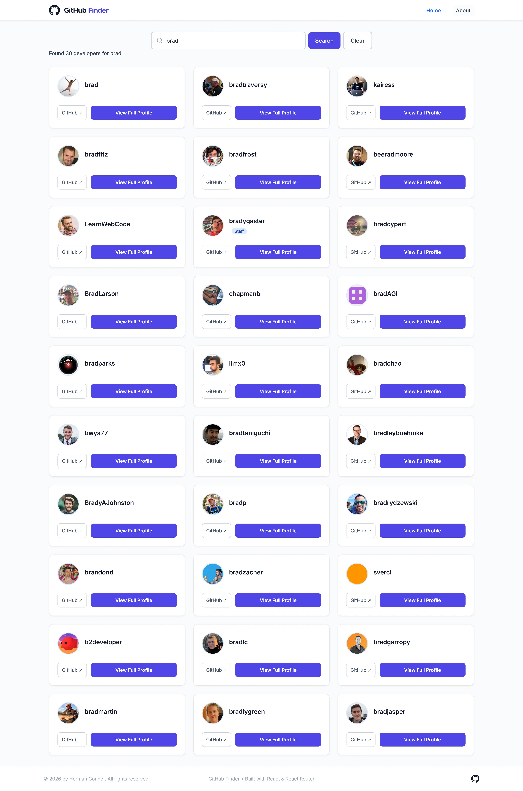
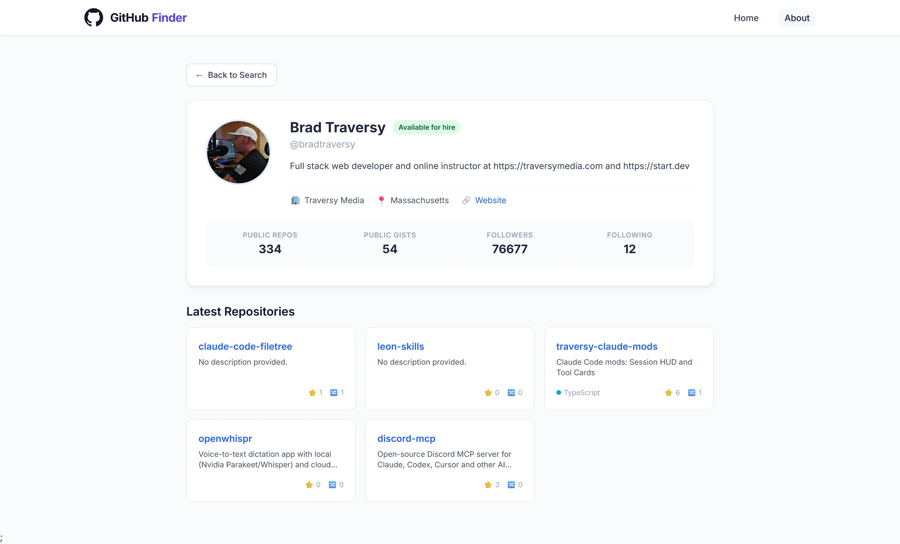
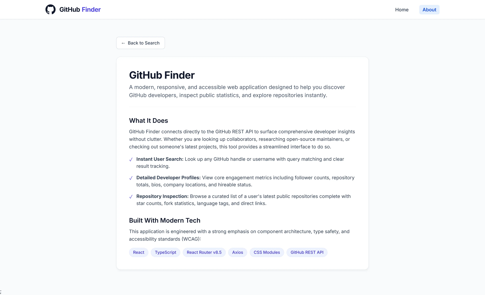
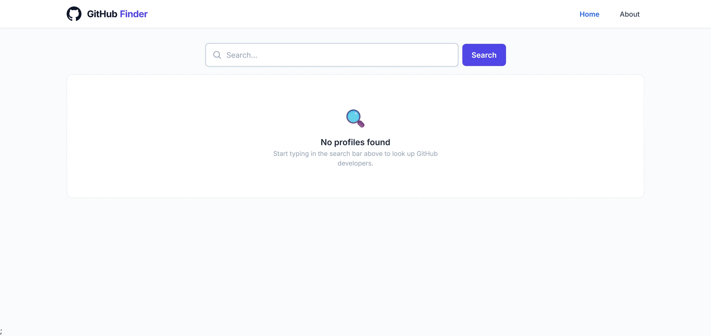
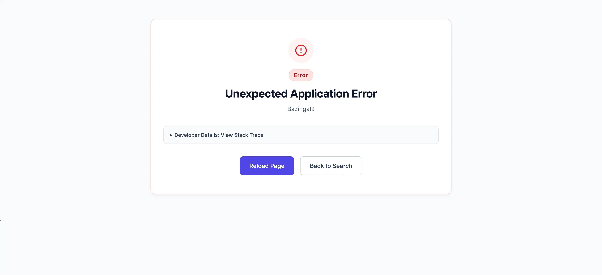

# 🔍 GitHub Finder

A modern, responsive, and accessible web application built with React and TypeScript to search and explore GitHub user profiles and repositories.



|                                                       |                                                       |
| :---------------------------------------------------: | :---------------------------------------------------: |
|  |  |
|  |  |

## Overview

GitHub Finder is a web application that uses the GitHub REST API to search for users and display information about their profiles and repositories.

## 🚀 Features

- **Instant User Search:** Look up GitHub handles with real-time query preservation and retry capabilities.
- **Detailed Profiles:** View developer bios, follower counts, company details, location, website links, and hireable badges.
- **Repository Inspection:** Browse a user's latest public repositories with language indicators, star counts, and fork statistics.
- **Robust State Management:** Powered by React's Context API and `useReducer` for clean predictable state handling (`loading`, `error`, `lastQuery`, `users`, `repos`).
- **Resilient Error Handling:** Includes custom `ErrorMessage` components with retry functionality, a 404 `NotFound` page, and a root `ErrorBoundary` with a **dev-only expandable stack trace**.
- **Accessible (a11y):** Built with semantic HTML (`<article>`, `<section>`, `<form role="search">`), keyboard navigation, and screen-reader utility classes (`srOnly`).

## 🛠️ Tech Stack

- **Framework:** React with TypeScript
- **Routing:** React Router v8+ (Data Router configuration)
- **State Management:** React Context API & `useReducer`
- **HTTP Client:** Axios
- **Notifications:** Sonner
- **Styling:** CSS Modules with CSS Variables

## ⚙️ Getting Started

### Prerequisites

Make sure you have **Node.js** (v18+ recommended) and **npm** installed on your machine.

### Installation

1. **Clone the repository:**

```bash
git clone https://github.com/hermanconnor/github-finder.git
cd github-finder
```

2. **Install dependencies:**

```bash
npm install
```

3. **Run the development server:**

```bash
npm run dev
```

4. **Open your browser:**
   Navigate to `http://localhost:5173` (or the port provided in your terminal).

## 🧠 What I Learned

- Integrating a React application with an external REST API.
- Managing shared state using Context and reducers.
- Modeling API data and component contracts with TypeScript.
- Organizing component styles using CSS Modules.
- Building responsive layouts with custom CSS.
- Applying semantic HTML and accessibility principles to interactive interfaces.

## Future Improvements

- Improve API request caching and loading performance.
- Add pagination or sorting for repository results, if appropriate.

## Acknowledgements

This project was inspired by the GitHub Finder project in [React Front To Back](https://www.udemy.com/course/modern-react-front-to-back/), a Udemy course created by Brad Traversy.

The course provided the original learning exercise, with a focus on external API integration and React state management. I developed my own TypeScript implementation and custom styling, with additional attention to responsive design, semantic HTML, and accessibility.
